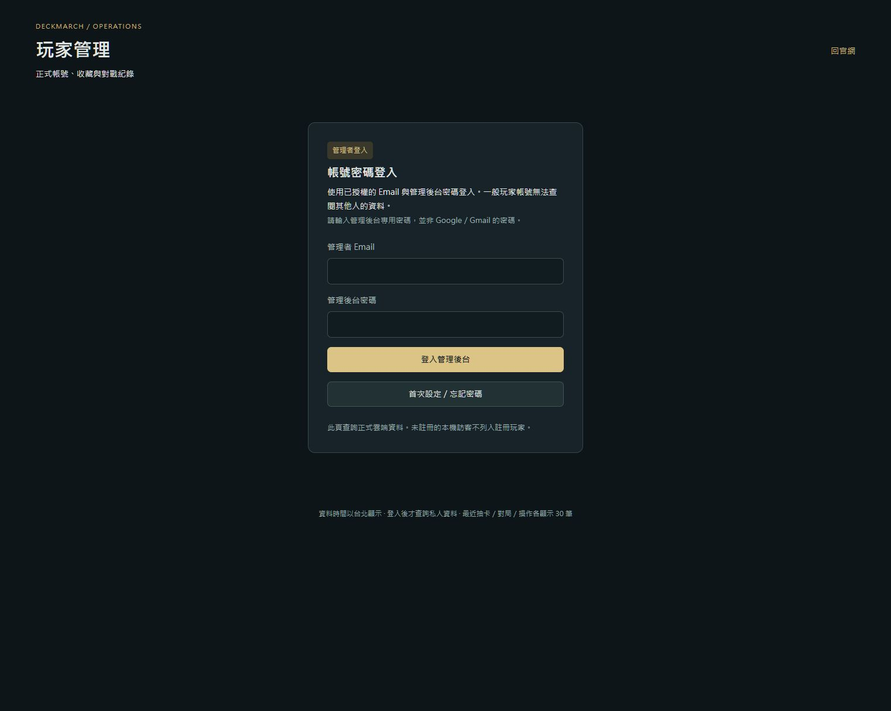
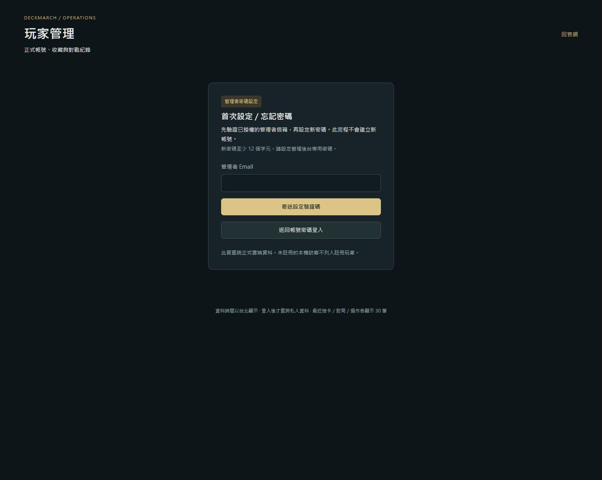

# 管理後台密碼登入 — 2026-10-24

`/admin` 的一般登入改為管理者 Email＋管理後台密碼。密碼屬於既有遊戲 Auth 帳號，不是 Google／Gmail 網站密碼。沒有重建帳號、改管理角色或新增 SQL 授權。

- 密碼登入後仍須通過資料庫 `tcg_admin_session`，一般玩家不能查看管理資料。
- 「首次設定／忘記密碼」才使用 Email OTP；`create_user:false` 不註冊新帳號。
- 信箱驗證成功後先查管理權限，寫入新密碼前再查一次；十分鐘內有效。取消後舊回覆不能復活登入或覆蓋同帳號的新設定。
- 密碼欄位遮罩、送出／取消清空；密碼與 token 不放 URL、storage、console 或原始碼。正式輸入及密碼設定的送出由管理者直接在頁面完成。
- 這次只修改 admin API、admin console、API 測試及管理指南；其他 Android／下載工作保留在工作目錄。

## 驗證

- API：38 項通過，包含非管理者拒絕、password grant、設定流程、刷新單次請求及晚到回覆競態。
- TypeScript 與改動檔案 ESLint：通過。
- 乾淨候選：已提交基底 `2f0e73e9` 加上述四檔，Next.js 16.4.2 production build（`--webpack`）通過。
- 同一份四檔在原工作目錄的預設 Turbopack build 通過；該工作目錄含別項未提交修改，不能冒充乾淨候選證據。
- 乾淨候選的預設 Turbopack 因外部 `node_modules` junction 超出 root 而失敗；沒有修改正式設定繞過，原始失敗 log 與結果保留。
- Chrome 本機原生頁面：一般登入、首次設定入口及返回流程完成檢查；截圖均為空白欄位，沒有使用真實密碼。
- 整合至下載修正後的 main `55810ea2` 時，四份管理程式來源雜湊不變，重新執行 API 38 項及完整 TypeScript 檢查均通過；新的下載 proxy 僅匹配 APK 路徑。
- 正式部署與真實管理者登入：另外由主代理／管理者驗收；本紀錄不把模擬 API 當作正式帳號已登入。

來源雜湊、完整命令、exit code 及 log SHA-256 見 [candidate.json](candidate.json)。

